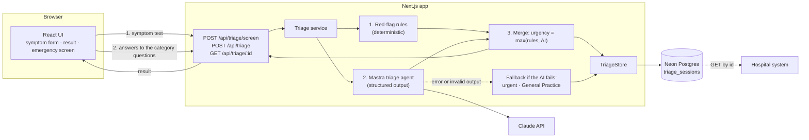

# Architecture



## Request flow

1. The UI posts only the symptom text to `/api/triage/screen` and shows a progress bar while it waits.
2. Red-flag rules run on the text. A match saves an emergency record and the UI goes straight to the emergency screen, with no follow-up questions.
3. Otherwise a screening agent returns `{ emergency, category }`. An emergency ends the flow as above. If the AI fails, the category is General Practice.
4. The UI asks two fixed questions (how long, how strong) and then the questions for that category from the fixed bank in `lib/triage/questions.ts` (Cardiology, Pulmonology, Gastroenterology, Dietetics, General Practice).
5. The UI posts everything to `/api/triage`. The route validates it with the Zod schema and checks the answers belong to the category.
6. Red-flag rules run again, now with the answers. A match returns an emergency result and the AI is skipped.
7. Otherwise the Mastra triage agent ranks pathways and picks an urgency and a consultation type. Its output is validated against the schema.
8. The final urgency is the higher of the rules result and the AI result.
9. If the AI fails or returns invalid output, the result is `urgent`, General Practice.
10. The result is stored and returned. The UI navigates to `/triage/[id]`, which shows either the result or, for emergencies, the full-screen emergency view.

## Key decisions

- **One Next.js app** serves the UI and the API. Route handlers stay thin; the triage logic lives in `lib/`.
- **The AI picks the category, not the questions.** Follow-up questions come from a fixed bank, so they are reviewable, testable and stored as stable ids.
- **Rules before AI.** Deterministic rules catch red flags such as crushing chest pain or trouble breathing. The AI can raise urgency but never lower it.
- **One Zod schema** is the contract for the form input, the AI output, the API response and the database row.
- **Storage behind an interface.** `TriageStore` has a Neon Postgres implementation (Drizzle, HTTP driver) and an in-memory one used when `DATABASE_URL` is not set.
- **Stable `id`.** Every result can be fetched later by id.

## Output

```json
{
  "id": "6f1c…",
  "urgency": "urgent",
  "pathway": "Cardiology",
  "next": "schedule",
  "consultationType": "first-appointment",
  "rankedPathways": ["Cardiology", "General Practice"],
  "nextSteps": ["…"],
  "reason": null,
  "source": "ai",
  "input": { "text": "…", "category": "Pulmonology", "duration": "few_weeks", "severity": "mild", "answers": { "lung_breathing": ["fine"] } },
  "createdAt": "2026-11-09T13:59:40.241Z"
}
```

| Field | Values |
| --- | --- |
| `urgency` | `emergency`, `urgent`, `routine` |
| `pathway` | `Cardiology`, `Pulmonology`, `Gastroenterology`, `Dietetics`, `General Practice` |
| `next` | `emergency`, `schedule` |
| `consultationType` | `emergency-assessment`, `first-appointment`, `check-up`, `cardiography`, `lung-function-test`, `diet-consultation` |
| `source` | `rules`, `ai`, `fallback` |

## Folder structure

```
src/
├── app/
│   ├── page.tsx                  # Symptom form (steps 1 and 2)
│   ├── triage/[id]/page.tsx      # Result or emergency screen
│   ├── not-found.tsx
│   └── api/triage/
│       ├── route.ts              # POST: run triage and store the result
│       └── [id]/route.ts         # GET: fetch a stored result
├── components/                   # React UI (flow, result card, emergency screen, ...)
└── lib/
    ├── triage/
    │   ├── schema.ts             # Zod schemas: the shared contract
    │   ├── rules.ts              # Red-flag rules
    │   ├── merge.ts              # urgency = max(rules, AI)
    │   ├── service.ts            # Orchestrates the flow
    │   ├── store.ts              # TriageStore interface + in-memory store
    │   └── ai-stub.ts            # Built-in assessment used without an API key
    ├── mastra/agent.ts           # Mastra triage agent
    ├── db/
    │   ├── schema.ts             # Drizzle table: triage_sessions
    │   └── store.ts              # Postgres TriageStore
    ├── labels.ts                 # Patient-facing wording
    └── config.ts                 # Emergency number
drizzle/                          # SQL migrations
docs/                             # DESIGN.md and other docs
neon.ts                           # Neon project config
```
