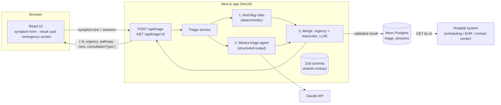

# Architecture



## Folder structure

```
src/
├── app/                          # Next.js App Router (UI + API)
│   ├── page.tsx                  # Landing page with symptom form
│   ├── triage/[id]/page.tsx      # Result page for a stored triage
│   └── api/triage/
│       ├── route.ts              # POST: run triage and store the result
│       └── [id]/route.ts         # GET: fetch a stored result by id
├── components/                   # React UI (form, result card, emergency screen)
└── lib/
    ├── triage/
    │   ├── schema.ts             # Zod schemas: the shared contract
    │   ├── rules.ts              # Deterministic red-flag rules
    │   ├── merge.ts              # Combines rules + AI output (urgency = max)
    │   └── service.ts            # Orchestrates the triage flow
    ├── mastra/
    │   └── agent.ts              # Mastra triage agent (structured output)
    └── db/
        ├── client.ts             # Neon connection
        └── schema.ts             # Drizzle table: triage_sessions
drizzle/                          # Generated SQL migrations
docs/                             # Extra documentation
```

Route handlers stay thin: they validate input, call `lib/triage/service.ts` and return the result. All triage logic lives in `lib/`, so it can be tested without HTTP.

## Key decisions

- **One Next.js app** serves the UI and the API. There is no separate backend to deploy.
- **Safety first.** Deterministic rules catch red flags (e.g. crushing chest pain, shortness of breath) and force `emergency`. The LLM can raise urgency but never lower it.
- **One Zod schema** is the contract for the LLM output, the API response and the database row.
- **Graceful fallback.** If the LLM fails or returns invalid output, the result falls back to the rules outcome plus a safe default (`urgent`, General Practice). The patient always gets guidance, never a bare error.
- **Stable `id`.** Every triage result is stored and can be fetched later by id, so a hospital system can consume it.

## Output contract

```json
{
  "id": "...",
  "urgency": "emergency | urgent | routine",
  "pathway": "Cardiology",
  "next": "schedule",
  "consultationType": "check-up"
}
```
